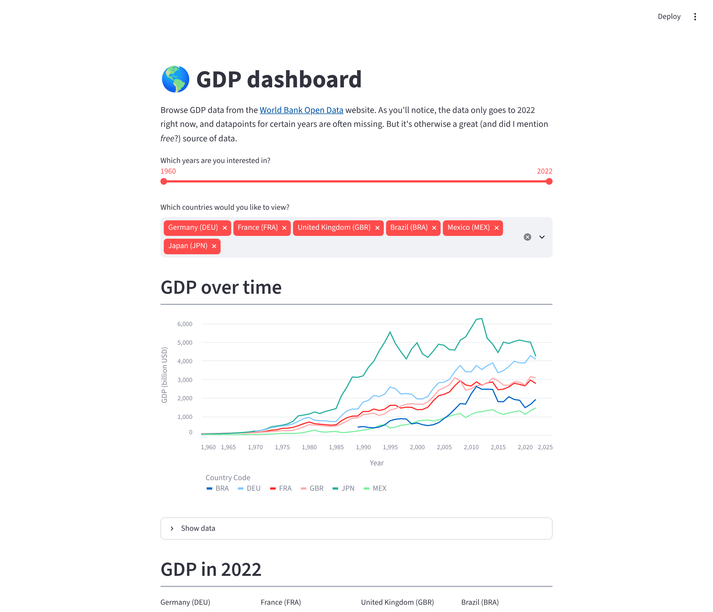
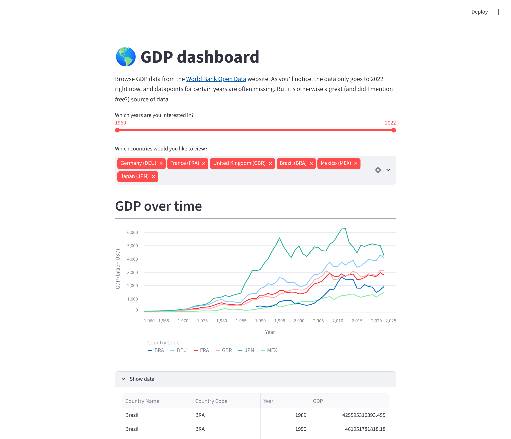

# :earth_americas: GDP dashboard template

A simple Streamlit app showing the GDP of different countries in the world,
based on [World Bank Open Data](https://data.worldbank.org/) (GDP, current US$, 1960-2022).

[](https://gdp-dashboard-template.streamlit.app/)



## Features

- Pick a year range with the slider and any number of countries (shown by name and code).
- Line chart of GDP over time in billions of USD.
- "Show data" expander with the underlying table for the selection.
- One metric per country: GDP in the end year, plus the growth multiple since the start year
  (`n/a` when either year has no data, e.g. Afghanistan in 2022).



## Project layout

| Path | Purpose |
| --- | --- |
| `streamlit_app.py` | Streamlit UI |
| `gdp_data.py` | Data loading/reshaping and calculations (no Streamlit dependency) |
| `data/gdp_data.csv` | World Bank GDP data, one column per year |
| `tests/` | pytest unit tests and an app smoke test |

## How to run it on your own machine

1. Install the requirements (Python 3.11+)

   ```
   $ pip install -r requirements.txt
   ```

2. Run the app

   ```
   $ streamlit run streamlit_app.py
   ```

## Tests

```
$ pip install -r requirements-dev.txt
$ python -m pytest
```

## Updating the data

Replace `data/gdp_data.csv` with a newer World Bank export in the same format. Year columns are
detected automatically, so no code change is needed.

## Known limitations

- The data includes regional/income aggregates (e.g. "World", "Euro area") alongside countries.
- The chart's year axis uses thousands separators (e.g. "1,960").
